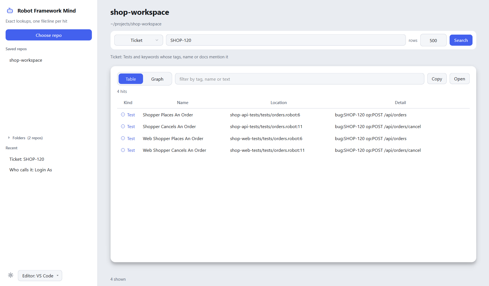
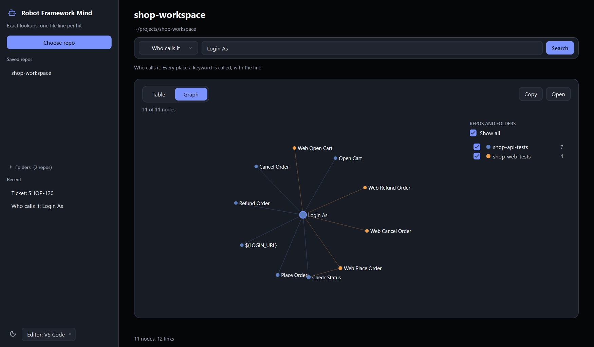

# robotframework-mind

Exact lookups over a Robot Framework test repo, for people and scripts. Ask
which tests cover a ticket, who calls a keyword or where an endpoint is used,
and get one line per hit with its `file:line` instead of reading whole suites.

It indexes:

- tests: name, tags (`bug:PROJ-123`, `role:...`, `op:GET /api/...`), first doc line, keyword calls
- user keywords: name, arguments, first doc line, calls, variables used
- variables from `*** Variables ***` and inline `VAR` statements, with their values
- suite and test setup/teardown calls
- JSON files under `docs/`, one entry per object key

## Requirements

Python 3.10+ and `robotframework` (the repo's own venv already has it). No
other packages.

## Run

From the test repo's venv:

```bash
python path/to/robot_mind.py --root <repo> ticket PROJ-123
python path/to/robot_mind.py --root <repo> kw "Open Profile Browser"
python path/to/robot_mind.py --root <repo> callers "Open Profile Browser"
python path/to/robot_mind.py --root <repo> tag role:role_quality_control
python path/to/robot_mind.py --root <repo> find /api/items/query
```

| Command | Returns |
|---|---|
| `ticket KEY` | tests and keywords whose tags, name or doc mention the key |
| `kw NAME` | every definition, matched the way Robot matches names (case, spaces and underscores ignored) |
| `callers NAME` | each call site: keyword, test or suite fixture, at the call line; falls back to substring when no exact name matches |
| `tag TAG` | tests with that tag; `role:*` matches a prefix |
| `find TEXT` | names, tags, docs, args, values and JSON entries containing the text, then the keywords that use a matching variable |

`--limit N` caps the lines (default 20). No hit prints `no match`. `--json`
prints the hits as a JSON array (each with `kind`, `name`, `file`, `line`; a
`callers` hit also carries `call_line`).

## Desktop app

The same lookups in a window. Pick a repo (or a folder that holds several),
choose what to search for, and get the hits as a table or as a graph of what
they call, use and hit. Open takes you to the file at the line in your editor.





Download a build from the releases page, or run it from source:

```bash
pip install -e .[gui]
python -m robot_mind_app
```

## How it compares

Five questions on a real API test repo (553 Robot and JSON files, 9,930
indexed entries), answered three ways: this tool, a plain `grep -rn` over the
same files, and graphify 0.9.102 (`graphify update`, then `graphify query`
with the question in words). Sizes are characters of output; "files" is how
many of the files that hold the answer the output names.

| Question | robotframework-mind | grep | grep, then open the matched files | graphify query |
|---|---|---|---|---|
| tests for a ticket (7 hits in 2 files) | 1,570 chars, 2 of 2 files | 2,181, 2 of 2 | 18,611 | 17,328, 0 of 2 |
| where a keyword is defined (1) | 167, 1 of 1 | 3,290, 1 of 1 | 346,452 | 6,804, 1 of 1 |
| who calls that keyword (30 calls in 10 files) | 3,411, 10 of 10 | 3,290, 10 of 10 | 346,452 | 6,802, 3 of 10 |
| tests with a tag (60 in 27 files) | 41,107, 27 of 27 | 38,363, 27 of 27 | 136,226 | 6,704, 0 of 27 |
| where an endpoint is used (8 in 6 files) | 2,879, 6 of 6 | 1,935, 6 of 6 | 2,642,809 | 6,838, 0 of 6 |

grep finds the same files and its matched lines are about as short, but a
matched line is the tag or the call, not the test or keyword around it, so
the next step is opening the files: that is the third column. graphify's
`explain` does better on keywords (all 10 caller files in 3,564 characters)
but found nothing for the ticket, the tag or the endpoint.

Building the index took 2.3 s the first time and 0.25 s after that; the
graphify build of the same repo took 44.9 s.

## How it stays current

The index lives in `~/.cache/robotframework-mind/`, one file per repo, never
in the repo. Each call compares file times and sizes and parses only changed
files. It reads each `.gitignore` on the way down (and `.git/info/exclude`)
itself, without calling git, so ignored probes and results stay out; a nested
repo follows only its own rules. Hidden folders, `node_modules`, `results` and
virtualenvs are skipped too. A file git tracks but a rule ignores is left out
as well. Files over the size cap are skipped: 5 MB for `docs/` JSON, 50 MB for
`.robot` and `.resource`.

## Tests

```bash
python -m unittest tests.test_where
```

## Credits

The parsing approach follows the Robot Framework extractor in
[graphify](https://github.com/Graphify-Labs/graphify) by Safi Shamsi
(Apache-2.0): Robot's own `robot.api` parser with a `ModelVisitor`, and
keyword names normalized the way Robot resolves them. No graphify code is
copied. See `NOTICE`.
